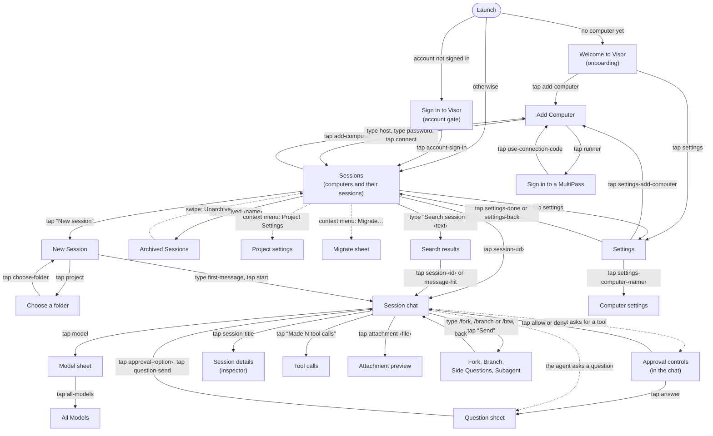

# Visor's feature map

What a person can reach in the Visor client, and how, drawn so that an
agent or a UI test can walk the same graph through Isomer's driver
protocol (isomer's `shared/wire/headless.proto`) on the iPhone and on
Android. Every screen below is a node; every arrow is the driver command
that takes it. The client is one SwiftUI tree, `VisorRootView`
(libraries/visor_ui), on every platform: Apple's SwiftUI on the iPhone,
iPad and Mac, Isomer's on Android and the web.

How to read it:

- **Arrows** are driver commands: `tap <target>`, `type <target> <text>`,
  `set`, `select`, `back`, `dismiss`, `wait <text>`. A target is an
  accessibility identifier (written as is, e.g. `add-computer`) or a
  label (in quotes, e.g. `"Send"`; “curly” in the diagram).
- **Dotted arrows** are steps a person can take that the driver can't
  yet (a context menu or a swipe action: the protocol has no long press),
  or that happen by themselves (a question arriving).
- `‹id›`, `‹name›`, `‹option›`, `‹file›` stand for a session's id, a
  computer's name, an answer's label and an attachment's file name.
- Leaving any sheet is `dismiss` (or its Done/Cancel); leaving a pushed
  page, or the chat on a phone, is `back`.



## Screens

How to tell where you are (`ls` lists a screen's texts and elements, and
any sheet or alert in `presented`), what's on it, and the fixture screen
that opens it directly (see "Driving it" below).

| Node | You're there when | Elements (identifier, or "label") | Fixture screen |
|---|---|---|---|
| Onboarding | text "Welcome to Visor" | `add-computer`, `settings` | `onboarding` |
| Sign in to Visor | text "Sign in to Visor" | `account-sign-in` | (launch argument `-visor.account fixture`) |
| Sessions | `computer-‹name›` and `session-‹id›` listed | `session-‹id›` (its `place-`, `waiting-`, `sub-sessions-‹id›` inside), `computer-‹name›`, `archived-‹name›`, `add-computer`, `settings`, "New session", the "Search sessions" field | `sessions`, `machines` |
| Search results | text "Messages" or `message-hit` | `message-hit`, `session-‹id›` | `search` (types "sync") |
| Archived Sessions | text "Archived Sessions" | `archived-session-‹id›` | none |
| Add Computer | a sheet; `host` and `connect` listed | `host`, `paste-code`, `password`, `authentication`, `connect`, `runner`, `provider-‹id›` (several providers), `copy-ssh-key`, `show-key-qr` (an SSH address) | `connect` |
| Sign in to a MultiPass | `multipass-code` or `runner-url` listed | `multipass-code`, `multipass-pair`, `runner-url`, `github-sign-in`, `github-code`, `runner-username`, `runner-password`, `runner-sign-in`, `use-connection-code` | `runner`, `runner-accounts` |
| New Session | a sheet; text "New Session" | `computer` (several computers), `choice`, `project`, `project-chosen`, `resume-id`, `title`, `first-message`, `start-error`, `start` | `new-session` |
| Choose a folder | text "Choose a folder" | `folder-path`, `choose-folder` | none |
| Session chat | `session-title` and "Send" listed | `session-title` ("Session details"), `attach`, `model`, `goal`, `loop`, `queued`, "Send", `busy-actions`, `dictate`, `copy-message`, `branch-message`, `share-message`, `attachment-‹file›`, `new-rows-pill`, `suggestion-/‹command›` | `chat`, `goal`, `earlier`, `commands` |
| Approval controls | `allow` and `deny`, or `answer`, listed | `allow`, `deny`, `answer` | `chat` (a Bash approval is pending) |
| Question sheet | a sheet; `question-send` listed | `approval-‹option›`, `question-own`, `question-skip`, `question-send` | `question` |
| Model sheet | a sheet; `all-models` or `approval-Auto Approve` listed | `approval-Auto Approve`, `approval-Manually Approve`, `all-models`, `compact` | `models` |
| All Models | `model-search` listed | `model-search` | none |
| Session details | text "About" | none of its own: "Done" (a phone's sheet), "Archive", "End session", "Stop Agent", "Restart Agent" | `inspector` |
| Tool calls | text "Tool calls" | "Done" | none |
| Fork, Branch, Side Questions, Subagent | its title: "Fork of …", "Branch of …", "Side Questions", or the subagent's description | the chat's | none |
| Settings | `settings-appearance` listed | `settings-computer-‹name›`, `settings-add-computer`, `settings-notify-waiting`, `-failed`, `-goal`, `-turn`, `settings-appearance`, `account-sign-out`, `runner-sign-out`, `runner-sign-in-again`, `runner-remove`, `settings-done` (a sheet) or `settings-back` (a pane) | `settings` (Mac's proof) |
| Computer settings | `relay-toggle` listed | `use-ssh`, `relay-toggle`, `back-up-sessions`, `show-qr`, `qr-code`, `copy-http-code`, `copy-https-code`, `copy-ssh-code`, `share-log` | none |

The fixture's canned data: one computer, "Snapshot Mac", with the sessions
`fixture-chat` ("Offline sync", Claude, a goal and a pending Bash
approval), `fixture-busy` ("Widget layout", Codex, mid-turn),
`fixture-docs` ("Release notes", a goal and a loop) and `fixture-api`
("Rate limits"). So `tap session-fixture-chat` opens a chat from the
`sessions` screen.

## By size

The graph is the same everywhere; what a node is differs with the width:

- **Phone (compact: iPhone, an Android phone):** one column at a time.
  Sessions, the chat and a pushed page are a stack (`back` returns);
  Settings and Session details are sheets (`dismiss`, or their Done);
  search and "New session" sit in the bottom bar.
- **Regular (iPad, the Mac, a wide window):** the sessions list and the
  chat side by side; Settings and Session details are a pane beside them,
  closed with `settings-back` or by tapping `session-title` again.
- **The Mac only:** the menu bar's Visor menu and Visor Server's own
  Settings window (password, network paths, push) are outside this
  graph: neither is part of `VisorRootView`.

Outside the app: `visor://connect?code=…` adds a computer (the Add
Computer sheet's end state), `visor://sign-in?computer=…` opens that
computer's page in Settings, and opening a push notification opens its
session's chat. There is no link to a session, and the iPhone's widget
only opens the app.

## Driving it

The protocol is Isomer's `isomer.wire.Command` / `Answer`
(isomer `shared/wire/headless.proto`): `cmd` is one of `ls`, `info`,
`inspect`, `tap`, `type`, `set`, `select`, `swipe`, `back`, `dismiss`,
`wait`, `quit`, and every answer carries the settled `Screen` (its
`texts`, its `elements` with `role`, `label`, `id`, `value`, and what's
`presented`). A `target` is matched, in order, as a screen name
(`button-3`), an element's `id` (its `accessibilityIdentifier`), a label
(the last exact match), then a label containing it. Identifiers are the
only exact, language-independent targets: prefer them; labels are
written above where there's no identifier.

From a shell, with Isomer's `iso` (`bazel run @isomer//xplat/iso -- …`),
or from Swift with `HeadlessApp` (`@isomer//headless/isomer_headless`):

```sh
iso --app android ls                      # where am I?
iso tap session-fixture-chat              # Sessions → Session chat
iso wait "Message Claude Code"
iso tap session-title                     # → Session details
iso dismiss                               # (a phone's sheet)
iso tap model                             # → Model sheet
iso tap all-models                        # → All Models
```

Launching into a fixture screen, with the app dialling the driver's hub
(`iso hub`, `ws://127.0.0.1:7710`):

- **Android** (emulator or the device lab's phone):
  `adb reverse tcp:7710 tcp:7710`, then
  `adb shell am start -n com.loganshire.visor/.MainActivity --es fixture snapshot --es fixture.screen chat -e ISO_DRIVER ws://127.0.0.1:7710 -e ISO_DRIVER_NAME android`.
- **iPhone simulator:**
  `SIMCTL_CHILD_ISO_DRIVER=ws://127.0.0.1:7710 xcrun simctl launch <udid> com.LoganShire.Visor -visor.fixture snapshot -visor.fixture.screen chat`
  (the fixture is read from launch arguments, which Isomer's
  `ios_launcher.sh` doesn't pass: launch it like this, or from a hosted
  XCTest).

## Not wired yet

What this map assumes that Visor doesn't do yet:

- **No build carries the driver.** Isomer builds it into a build with
  `--@isomer//drive:headful`; Visor's `.bazelrc` has no `build:drive`
  line for it. On Android that flag is all it takes (`visor_android` is
  an `isomer_android_app`); the iPhone app, on Apple's SwiftUI, also has
  to depend on `@isomer//:isomer`, which brings Isomer's Apple driver
  (it reads the app's accessibility tree). Release builds never carry
  it.
- **Steps the driver can't take:** context menus (a session's Rename,
  Migrate…, Project Settings, Remove…) and swipe actions (Archive,
  Unarchive) need a long press or a swipe on a row, which the protocol
  doesn't have.
- **Elements without an identifier:** the composer's text field (found
  by its "Message ‹Agent›…" label), the "New session" button in the iPad's
  toolbar, and Session details' rows and buttons. Labels work but change
  with the language.
- **Today's tests don't use the driver:** the proofs open each fixture
  screen with a fresh launch and take its picture
  (tools/ci/proof_ios.sh, proof_android.sh, proof_mac.sh); the iPhone's
  UI tests are XCUITest (tests/ios_probe), Android's use UI Automator
  (tools/isomer/uitests/android_flow.py).

When a screen, a way between screens or an identifier above changes,
change this map with it.
