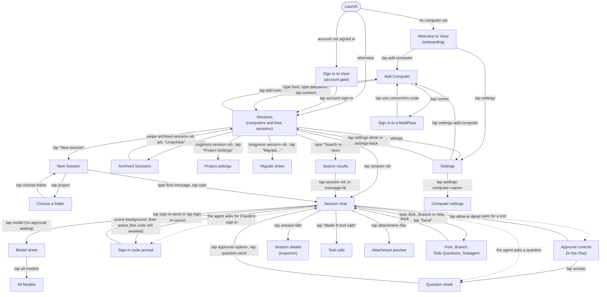

# Visor's feature map

What a person can reach in the Visor client, and how, drawn so that an
agent or a UI test can walk the same graph through Isomer's driver
protocol (isomer's `shared/wire/headless.proto`) on the iPhone and on
Android. Every screen below is a node; every arrow is the driver command
that takes it. The client is one SwiftUI tree, `VisorRootView`
(libraries/visor_ui), on every platform: Apple's SwiftUI on the iPhone,
iPad and Mac, Isomer's on Android and the web.

How to read it:

- **Arrows** are driver commands: `tap <target>`, `type <target> <text>`,
  `set`, `select`, `longpress <target>` (a context menu, its items then
  the screen's buttons), `swipe <row> left|right` (a row's swipe actions),
  `back`, `dismiss`, `wait <text>`, `scene background|active` (leaving the
  app and coming back). A target is an
  accessibility identifier (written as is, e.g. `add-computer`) or a
  label (in quotes, e.g. `"Send"`; “curly” in the diagram).
- **Dotted arrows** are steps that happen by themselves (a question
  arriving), not commands.
- `‹id›`, `‹name›`, `‹option›`, `‹file›` stand for a session's id, a
  computer's name, an answer's label and an attachment's file name.
- Leaving any sheet is `dismiss` (or its Done/Cancel); leaving a pushed
  page, or the chat on a phone, is `back`.



## Screens

How to tell where you are (`ls` lists a screen's texts and elements, and
any sheet or alert in `presented`), what's on it, and the fixture screen
that opens it directly (see "Driving it" below).

| Node | You're there when | Elements (identifier, or "label") | Fixture screen |
|---|---|---|---|
| Onboarding | text "Welcome to Visor" | `add-computer`, `settings` | `onboarding` |
| Sign in to Visor | text "Sign in to Visor" | `account-sign-in` | none: launch with the setting `account=fixture` and no `fixture` (the fixture skips the account) |
| Sessions | the navigation title "Sessions", and the rows "Snapshot Mac", "Offline sync" (`computer-‹name›` and `session-‹id›`); `add-computer` too, but on the iPhone on its side, or after an account's sign-in, it can be below the fold | `session-‹id›` (its `place-`, `waiting-`, `sub-sessions-‹id›` inside), `computer-‹name›`, `archived-‹name›`, `add-computer`, `settings`, "New session", the "Search sessions" field | `sessions`, `machines` |
| Search results | text "Messages" or `message-hit` | `message-hit`, `session-‹id›` | `search` (types "sync") |
| Archived Sessions | text "Archived Sessions" | `archived-session-‹id›` | none (the fixture has no archived sessions) |
| Project settings | the project's page, titled by its name: "Copy folder path" listed | "Rename in Visor…", "Copy folder path", "Archived Sessions (‹n›)", "Remove Project" | none: `longpress session-fixture-chat` on `sessions`, then tap "Project Settings" (not on the iPhone yet: see "Not wired yet") |
| Add Computer | a sheet; `host` and `connect` listed | `host`, `paste-code`, `password`, `authentication`, `connect`, `runner`, `provider-‹id›` (several providers), `copy-ssh-key`, `show-key-qr` (an SSH address) | `connect` |
| Sign in to a MultiPass | `multipass-code` or `runner-url` listed | `multipass-code`, `multipass-pair`, `runner-url`, `github-sign-in`, `github-code`, `runner-username`, `runner-password`, `runner-sign-in`, `use-connection-code` | `runner` |
| New Session | a sheet; text "New Session" | `computer` (several computers), `choice`, `project`, `project-chosen`, `resume-id`, `title`, `first-message`, `start-error`, `start` | `new-session` |
| Choose a folder | text "Choose a folder" | `folder-path`, `choose-folder` | none |
| Session chat | `session-title` and "Send" listed (on the iPhone, with the composer empty, "Dictate" stands where "Send" is); in `commands` the iPhone shows the slash commands in a popover over the chat, and the driver lists only the popover | `session-title` ("Session details"), `attach`, `model` and `goal` (not while an approval or question waits: Approval controls take their place), `loop`, `queued`, "Send", `busy-actions`, `dictate`, `copy-message`, `branch-message`, `share-message`, `attachment-‹file›`, `new-rows-pill`, `suggestion-/‹command›` | `chat`, `goal`, `earlier`, `commands` |
| Approval controls | `allow` and `deny`, or `answer`, listed | `allow`, `deny`, `answer` | `chat` (a Bash approval is pending) |
| Question sheet | a sheet; `question-skip` listed (`question-send` enabled only once every question has an answer) | `approval-‹option›`, `question-own`, `question-skip` ("Skip"), `question-send` ("Send") | `question` |
| Sign-in code prompt | a sheet; text "Paste the code Claude showed after you signed in." or `sign-in-paste` listed | `sign-in-code` (the "Code from the sign-in page" field), `sign-in-paste` ("Paste"), `sign-in-send` ("Send", listed once a code is typed), `sign-in-cancel` ("Cancel") | `sign-in-code` opens the chat with its Claude Code waiting on a sign-in, under the "Sign In to Claude" alert: tap "Open Sign-In Page", and the prompt opens when Visor is back in front (where nothing says it left for the page, as headless, a second later). It opens again on each return while the code is awaited (`scene background`, then `scene active`), not once it's sent or the sign-in has ended. The code goes as the composer sends it, which still takes it ("Later", then type it there); the fixture's computer answers a code with the notice "Signed in to Claude again with the code ‹code›." |
| Model sheet | a sheet; `all-models` or `approval-Auto Approve` listed | `approval-Auto Approve`, `approval-Manually Approve`, `all-models`, `compact` | `models` |
| All Models | `model-search` listed | `model-search` | none (`all-models` appears only for a long catalog; the fixture's catalogs are short) |
| Session details | text "About" | `details-title`, `details-copy-resume`, `stop-agent`, `start-agent`, `restart-agent`, `details-archive`, `details-end`, `details-done` (a phone's sheet) | `inspector` |
| Tool calls | text "Tool calls" | "Done" | none |
| Attachment preview | a sheet with "Done"; on the iPhone it is Quick Look, whose button is "close" | "Done" ("close" on the iPhone), "Share" | none (the `chat` fixture's two attachments are both labelled "Open the attachment": tap them by `attachment-‹file›`) |
| Fork, Branch, Side Questions, Subagent | its title: "Fork of …", "Branch of …", "Side Questions", or the subagent's description | the chat's | none |
| Settings | `settings-appearance` listed | `settings-computer-‹name›`, `settings-add-computer`, `settings-notify-waiting`, `-failed`, `-goal`, `-turn`, `settings-appearance`, `account-sign-out`, `runner-sign-out`, `runner-sign-in-again`, `runner-remove`, `settings-done` (a sheet) or `settings-back` (a pane) | `settings` (Mac's proof) |
| Computer settings | `share-log` or "Network paths" listed | `use-ssh`, `relay-toggle`, `back-up-sessions`, `show-qr`, `qr-code`, `copy-http-code`, `copy-https-code`, `copy-ssh-code`, `share-log` | none |

The fixture's canned data: one computer, "Snapshot Mac", with the sessions
`fixture-chat` ("Offline sync", Claude, a goal and a pending Bash
approval), `fixture-busy` ("Widget layout", Codex, mid-turn),
`fixture-docs` ("Release notes", a goal and a loop) and `fixture-api`
("Rate limits"). So `tap session-fixture-chat` opens a chat from the
`sessions` screen. To start a walk from the chat with the model pill
showing, use the `goal` fixture (the `chat` fixture has an approval
waiting).

## By size

The graph is the same everywhere; what a node is differs with the width:

- **Phone (compact: iPhone, an Android phone):** one column at a time.
  Sessions, the chat and a pushed page are a stack (`back` returns);
  Settings and Session details are sheets (`dismiss`, or their Done);
  search and "New session" sit in the bottom bar.
- **Regular (iPad, the Mac, a wide window):** the sessions list and the
  chat side by side; Settings and Session details are a pane beside them.
  Session details closes by tapping `session-title` again, Settings by
  tapping `settings` again; from a computer's page, `settings-back`
  returns to Settings. "New session" is in the toolbar (`new-session`).
  Android on its side (1080×2400 at 420 dpi, the proof's and the
  suite's emulator) is regular width too: the list sits beside the chat,
  and `back` from the chat has nothing to go back from.
- **The Mac only:** the menu bar's Visor menu and Visor Server's own
  Settings window (password, network paths, push) are outside this
  graph: neither is part of `VisorRootView`.

Outside the app: `visor://connect?code=…` adds a computer (the Add
Computer sheet's end state), `visor://sign-in?computer=…` opens that
computer's page in Settings, and opening a push notification opens its
session's chat. There is no link to a session, and the iPhone's widget
only opens the app.

## Driving it

The protocol is Isomer's `isomer.wire.Command` / `Answer`
(isomer `shared/wire/headless.proto`): `cmd` is one of `ls`, `info`,
`inspect`, `tap`, `type`, `set`, `select`, `swipe`, `longpress`, `back`,
`dismiss`, `scene`, `wait`, `quit`, and every answer carries the settled `Screen` (its
`texts`, its `elements` with `role`, `label`, `id`, `value`, and what's
`presented`). A `target` is matched, in order, as a screen name
(`button-3`), an element's `id` (its `accessibilityIdentifier`), a label
(the last exact match), then a label containing it. Identifiers are the
only exact, language-independent targets: prefer them; labels are
written above where there's no identifier.

The suite that walks this map is `//tests/feature_map_tests`
(`bazel test --config=headless //tests/feature_map_tests/...`, in a
Linux container, nothing drawn): every node is reached and checked as in
the table, and every solid arrow is taken, except where the fixture
hasn't what it needs (Archived Sessions, Migrate, All Models, a fork):
those, and the dotted ones, are disabled tests that say why. It drives the headless client,
`//applications/visor_headless` (`VisorRootView` on Isomer's headless
host, offline, its settings from the environment). docs/DEVELOPMENT.md,
"Driving the client", has the whole recipe.

From a shell, with Isomer's `iso` (`bazel build @isomer//xplat/iso`),
or from Swift with `HeadlessApp` (`@isomer//headless/isomer_headless`).
The headless client, serving the driver on a socket:

```sh
bazel build --config=headless //applications/visor_headless
root="$(bazel info execution_root)"
visor="$root/$(bazel cquery --config=headless --output=files //applications/visor_headless)"
env fixture=snapshot fixture.screen=sessions \
    ISO_DRIVE_LISTEN=unix:/tmp/visor.sock ISO_HEADLESS_PROTOCOL=serve "$visor" &
iso --url unix:/tmp/visor.sock ls
```

Then, against it or a headful build (`--config=drive`) attached to `iso hub`:

```sh
iso ls                                    # where am I?
iso tap "Offline sync"                    # Sessions → Session chat
iso wait "Message Claude Code"
iso tap session-title                     # → Session details
iso tap details-done                      # (a phone's sheet)
iso back                                  # → Sessions
iso tap settings                          # → Settings
```

Launching a headful build (`--config=drive`) into a fixture screen, with
the app dialling the driver's hub (`iso hub`, `ws://127.0.0.1:7710`):

- **Android** (emulator or the device lab's phone):
  `adb reverse tcp:7710 tcp:7710`, then
  `adb shell am start -n com.loganshire.visor/.MainActivity --es fixture snapshot --es fixture.screen chat -e ISO_DRIVER ws://127.0.0.1:7710 -e ISO_DRIVER_NAME android`.
  Every launch setting is an extra (`--es account fixture`,
  `--es fixture.appearance dark`, `--es fixture.orientation landscape`, …).
- **iPhone simulator:** the app reads its launch settings from its
  environment as `visor.<key>` (a bare `fixture` or `account` is left
  alone), so simctl's `SIMCTL_CHILD_` prefix passes them, as Isomer's
  `ios_launcher.sh` does:
  `env SIMCTL_CHILD_ISO_DRIVER=ws://127.0.0.1:7710 SIMCTL_CHILD_visor.fixture=snapshot SIMCTL_CHILD_visor.fixture.screen=chat xcrun simctl launch <udid> com.LoganShire.Visor`
  (`env`, because a shell won't take a name with a dot as an
  assignment); or as launch arguments, after the bundle id:
  `-visor.fixture snapshot -visor.fixture.screen chat`.

The launch settings are `fixture`, `fixture.screen`,
`fixture.appearance`, `fixture.orientation`, `fixture.go`, `account` and
`probe.open` (libraries/visor_services, `VisorLaunchSettings`); the
headless client takes the same list under the bare names, as
Android's extras do. The suite runs headful on the
iPhone and Android through Isomer's launchers
(`//tests/feature_map_tests:feature_map_headful_{ios,android,macos}_test`,
manual), and the iPhone's and Android's release proofs walk this map
through the driver (`//tests/feature_map_tests:feature_map_proof_‹platform›`).

## Not wired yet

What this map assumes that Visor doesn't do yet. (Isomer's driver lists
every identifier above, on Isomer's runtime and through its Apple driver
on the iPhone, and its `dismiss` closes Visor's sheets and Quick Look,
since isomer#228 and #231; the suite takes them all by identifier.)

- **Coming back to Visor on the iPhone:** since isomer#236 the iPhone's
  launcher moves the scene itself (`scene(.background)` sends Visor home,
  `scene(.active)` brings it back, waking it if iOS suspended it), so the
  sign-in tests no longer hang behind Safari. But on a simulator with no
  Simulator.app (a Shireworks Mac slot), a scene brought back from the
  home screen stays inactive: SwiftUI's phase stops at `.inactive`, and
  the launcher answers `ok` without leaving the last step to the driver.
  Visor asks for the code again only on `.active`, so "Sign-in code
  prompt, again: leave Visor and come back" fails there in most runs
  (Isomer's to fix). Coming back from the sign-in page (send, cancel)
  passes: there the launcher leaves the phase to the driver. Its alert's
  buttons, the prompt's field and a long press are all driven there since
  isomer#234.
- **What the iPhone lists is what is on its screen:** a control below the
  fold (the onboarding's `add-computer`, Computer settings' `relay-toggle`
  and `share-log`) isn't in `ls` until it is scrolled to, though `tap`
  finds it.
- **`back` in a sheet:** on Isomer, `back` on a page pushed inside a
  sheet (Settings → a computer's page) closes the whole sheet.
- **Elements without an identifier:** the composer's text field, which
  lives in AgentUI (found by its "Message ‹Agent›…" placeholder).
- **Not in the fixture:** Archived Sessions (and so Unarchive), Migrate (a
  second computer that migrates), All Models, a fork, a branch and a
  subagent can't be reached in fixture mode; their tests are disabled
  until it has them.
- **The rest of the tests don't use the driver yet:** the iPhone's and
  Android's proofs and the suite headful on both do, but the Mac's proof
  still opens each fixture screen with a fresh launch
  (tools/ci/proof_mac.sh), the iPhone's UI tests are XCUITest
  (tests/ios_probe), and Android's use UI Automator
  (tools/isomer/uitests/android_flow.py).

When a screen, a way between screens or an identifier above changes,
change this map with it.
