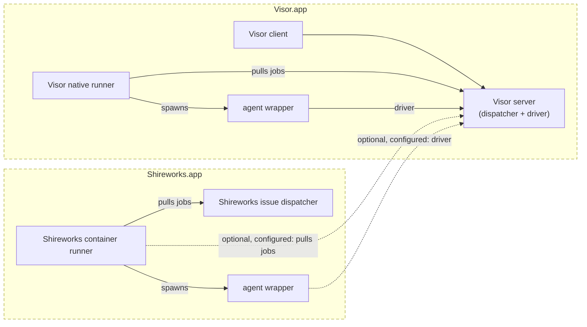

# agent_protocol

What [Visor](https://github.com/AttilaTheFun/visor) and Shireworks share
about agents, and the one program both run their agents under. Visor and
Shireworks are standalone apps; this is how they interact.

- **Three gRPC services** (`protos/agent_protocol/v1`):
  - **AgentDispatcher**: the queue of agent jobs. Runners pull from it, as
    GitHub's runners pull CI jobs. Visor's server implements it, and so does
    Shireworks' server (its jobs from GitHub issues).
  - **AgentDriver**: where an agent is watched and steered. The wrapper
    dials out to it (`AGENT_DRIVER_URL`) and keeps one stream open: its
    conversation and what it is doing go up, and messages, permission
    answers, model changes and interrupts come down. It's `claude -p`
    across harnesses, over gRPC, outbound from the agent. Visor's server
    implements it.
  - **AgentWrapper**: the wrapper itself, for the runner that started it.
- **`agent-wrapper`**: normalizes Claude, Codex and the other harnesses into
  one interface, and keeps what isn't in their logs (thinking, subagents,
  tool calls under way) and the queued messages. The driver is optional:
  without one, a job runs headless.
- **An agent's id** is a UUID with its dispatcher's URL (as runners reach it,
  through MultiPass), made before any session exists, and carried from
  dispatcher to runner to wrapper to driver.



Dashed boxes are the apps, solid ones the parts in them, and dashed arrows
optional links, configured. MultiPass's proxying is left out: every link
out of a container, and all of an agent's outbound traffic, goes through it.

## Building

```sh
swift build                    # AgentProtocol and agent-wrapper
swift test
tools/generate.sh              # the protos' Swift, after changing a proto (needs protoc)
tools/build_static.sh out      # agent-wrapper as one static file per Linux architecture (Swift 6.4.0)
```

`tools/build_static.sh` builds with Swift's static Linux SDK (musl), so
`agent-wrapper-linux-arm64` and `-amd64` run in any container image, with
nothing to install. gRPC's TLS (NIOSSL's BoringSSL) is C++, so the script
links the SDK's libc++ alone (its comments say how).

The protos' Swift is generated and kept in `Sources/AgentProtocol`, so a
package that depends on this one needs no protoc. CI checks it matches.

## agent-wrapper

```sh
AGENT_DRIVER_URL=http://127.0.0.1:7434 agent-wrapper --agent <uuid> --dispatcher <url> \
    --harness claude --cwd ~/Developer/project --title "A task" --prompt "Start here"
```

It runs the harness (Claude Code in print mode, stream JSON both ways),
sends its first prompt, and takes later messages from its driver. It ends
when the agent does. `AGENT_WRAPPER_CLAUDE` stands in for `claude`, as
the tests' stand-in does.

**A session moved to a runner** comes as a job with `resume_session_id` and
`sources`. Before the harness starts, the wrapper:
- fetches the conversation's files from its driver (`AgentDriver.Conversation`)
  into Claude's folder (`$CLAUDE_CONFIG_DIR`, else `~/.claude`), keyed to the
  folder it will work in;
- clones each source under `AGENT_SOURCES_DIR` by its name and ref;
- then runs `claude --resume`.
Nothing already there is overwritten. A job with no working directory, on a
runner that sets `AGENT_SESSIONS_DIR`, works in `<dir>/Claude/<agent>`.

Not yet: Codex and OpenRouter, permission prompts relayed to the driver,
interrupts and model changes, and the AgentWrapper service. Its harnesses
will come from Visor's agent code (visor_agent).

## Licence

Apache 2.0, as Visor's.
