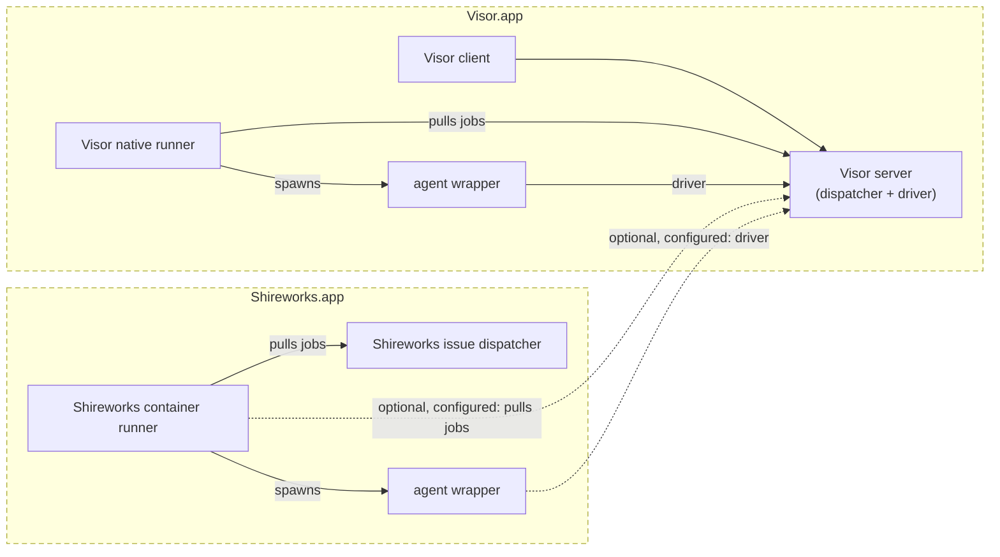

# Agents, runners and a server that relays (design, Visor 0.50+)

Logan, 11 Nov 2026 (via Manager), in his words:

> the visor server can just be a dumb http server embedded in the mac app
> which is a menu bar app plus client and has three types of clients:
> wrapped agents dialing in through multipass either natively or from a
> container; client apps like the mac's own client or a phone client; agent
> runners asking should start a new agent from a queue.

> agents are just agents that have advertised themselves to the visor server
> and the visor server is caching their state and relaying clients to them.

His motivation is **agent jobs** in Shireworks. An agent job is a container CI
job that runs one agent session: for example, implementing a GitHub issue,
opening a pull request and merging it. The job is archived automatically when
the task reaches a terminal state. While it runs it shows in Visor, to be
watched and steered, and it can be unarchived afterwards. Neither the server
nor a client asks for such a session. The job creates it.

This document is the outline Logan asked for before building. It changes
docs/server-proxy.md (#329) in one place: the Visor server no longer runs or
owns agents. MultiPass, the egress proxy, DNS and sign-in all stay as #329 has
them. Containers dial out only, through MultiPass, at
`SHIREWORKS_HOST_ADDRESS` (Shireworks, 11 Nov). Nothing reaches into a
container.

## The shape (Logan, 12 Nov): agent_protocol, and two standalone apps

Logan, 12 Nov 2026 (via Manager): Visor's MCP goes, agents' messages become
prefixed messages the client delivers, and a public repository,
`agent_protocol`, holds what Visor and Shireworks share: three gRPC
services (AgentWrapper, AgentDispatcher, AgentDriver) and the one
`agent_wrapper` binary. Visor and Shireworks are standalone again, joined
only by it. Where this section and the rest of the document differ, this
section wins: the wire below (`/api/v2/…` JSON) becomes agent_protocol's
services, and its sections are rewritten as that work lands. Nothing is
built until Logan answers the plan's questions.

His drawing: dashed boxes are the `.app` bundles, solid ones the parts in
them (some separate binaries, some the same), dashed arrows optional links
that are configured. MultiPass's proxying is left out for simplicity: every
link out of a container, and every agent's outbound traffic, goes through
it.

What it settles:
- Visor's native runner pulls only from Visor's dispatcher, and a native
  wrapper always has Visor as its driver.
- Shireworks' runner always pulls from its own (GitHub issues) dispatcher,
  and from Visor's when configured; its wrappers use Visor as their driver
  only when configured (`AGENT_DRIVER_URL`, Shireworks' Settings). Without
  one, a job runs headless.
- `agent_wrapper` is one component, from agent_protocol, shipped in both
  bundles. Its core is what step 3 moved into visor_agent.
- The agent id, a UUID with its dispatcher's URL, is made by the dispatcher
  before any session exists, and goes dispatcher → runner → wrapper →
  driver.
- The drawing shows one Visor.app's client and its own server. It isn't a
  rule: a client (the iPhone's included) still connects to several
  computers' servers, and carries agents' messages between them, as today.

Logan's answers to the plan's questions (12 Nov):
- **Messages:** relayed purely by the client, never by a server. A message
  to an agent that is disconnected (gone without ending, as in an outage)
  is kept by the client, shown as sending, until an agent receives it.
  Every sending message shows at once, optimistically, until it's received
  or trashed; one that can't go says "Send failed", with trash and retry
  below it. The client shows the agent as disconnected. The message's
  syntax is still open.
- **agent_wrapper's core** is visor_agent's, moved into agent_protocol.
  agent_protocol is Apache 2.0, as Visor and Isomer are.
- **Visor's native runner** works much as native sessions do today, not
  sandboxed; on a pure Mac they're simply avoided, since they can read and
  write in many places.
- **The agent id's dispatcher URL** is its address through MultiPass, so a
  runner reaches a dispatcher over the tailnet, the LAN or localhost: a
  container session on the mini, started from the MacBook's Visor while
  travelling.
- **Shireworks' dispatcher** is Shireworks' server, acting on issues as
  logan-shire-works, over every repository of Logan's that isn't archived
  and carries the status labels. For now it runs every session in
  Shireworks' primary agent container (later perhaps ephemeral, like CI
  jobs: an implementation detail).
- **Issues** refreshes a page as it appears, on coming back to the
  foreground, and on pull to refresh.
- **The GitHub Apps** (Logan, 12 Nov): each App acts for one kind of caller,
  and its key is held by one place only.
  - **logan-shire-runner** is CI's: Shireworks' runners register with it and
    run CI jobs as it.
  - **logan-shire-works** is Shireworks': its server, its dispatcher (acting
    on issues), and its clients.
  - **logan-shire-agent** is the agents': every GitHub request an agent
    makes goes out as it.
  - MultiPass holds logan-shire-agent's key and adds the App's token to an
    agent's GitHub traffic as it proxies it (its GitHub proxy and gate).
  - No agent's container, and no runner, wrapper or agent process, ever
    holds that token or the key.
- **agent_protocol** has its own repository, AttilaTheFun/agent_protocol
  (split out of visor's `agent_protocol/` with its history, 12 Nov).
  - Visor and Shireworks depend on it by released version (from v0.1.0),
    not by a visor commit or a folder.
  - Visor's copy is gone: Visor depends on 0.1.0 (its server's services
    by SwiftPM and rules_swift_package_manager, the Mac app's agent-wrapper
    from the release's package).
- **Existing sessions** all move: first to run natively, then the
  co-tenant container goes, Shireworks' primary container is made, and
  they move into it (a phase of its own, planned with Shireworks).

## Logan's answers (11 Nov, later)

Where this section and the rest of the document differ, this section wins.
The sections below have been brought into line with it.

- **No server has auth of its own.** The Visor server, the runners and
  Shireworks are plain HTTP servers on native ports, never exposed directly.
  MultiPass is the one authenticated way in, for remote clients over the LAN
  or tailnet and for agents in containers alike. It switches paths, signs
  people and agents in, and decides which credentials to add when it proxies,
  so nothing untrusted is ever handed a secret. It is also the one port a
  container reaches, mapped from the container to the host.
- **A session's logic lives in the wrapped agent.** That also makes a session
  easy to move between runners.
- **Runners own their sessions' data.**
  - Data lives in the Sessions volume, but the runner that created a session
    manages it: Shireworks' agent runner for container sessions, Visor.app's
    native runner for native ones.
  - A runner is fairly dumb. It keeps track of the sessions it has started and
    where their data is.
  - Archiving goes client → server → wrapped agent. The agent archives itself
    and tells its runner, which tells the Visor server.
  - **Migrate** copies a session's data from one runner to another, and the
    receiving runner starts the copy.
  - **Backup…**, from a session's context menu, copies the same data to a
    folder the user picks.
- **Placement:**
  - The MacBook has a Shireworks server with no primary container, and
    Visor.app with its native runner.
  - The mini has a Shireworks server with the primary container.
  - Shireworks' agent runner is enabled only where Shireworks has a primary
    container, so container sessions run in the mini's primary container and
    native ones on the MacBook.
  - In the medium term, native sessions are avoided where possible on
    Logan's own pure MacBook. That's his choice for his machine, not
    Visor's: see "The native runner" below.
- **Progress and done:** a wrapped agent reports to the runner that started it
  over that runner's MCP: agent → wrapper → MultiPass → Shireworks' agent
  runner. It reports progress from time to time, and says complete or blocked.
  A runner may stop an agent that has been stuck for some time and mark it
  blocked.
- **Merging:**
  - A pull request that touches no code-owned file: the agent merges it, as
    agents do today.
  - One that touches a code-owned file: the agent marks itself blocked on code
    review. Logan moves the issue back to a status the runner watches, and the
    runner resumes the agent.
- **Scope:** every repository that isn't archived. For the pilot, agent jobs
  are started by hand only. Picking up and implementing issues automatically,
  with a cap on concurrent agent and CI jobs, comes when the Mac Studio
  arrives.

## The native runner, and Visor on its own

Logan, 11 Nov: "I think 3rd parties may still want to use the native visor
agents either because they don't care as much about the purity of the machine
or their build process is more complex and requires tools that can't work on
linux."

And, in his words: "it's not that it's the default. you can use Visor.app
without Shireworks.app and then you'd be limited to native sessions, or some
custom deployment you create like the enterprise deployment with abox and
sandcastle."

So **no placement is Visor's default.** A session runs wherever the user's
paired runners are:
- **Visor.app alone** brings its native runner, and only native sessions.
- **Shireworks** adds its container and macOS VM runners.
- **A custom deployment** brings runners of its own, for example an
  enterprise one on abox and sandcastle.

Visor.app's native runner is a first-class, supported part of Visor, not a
step on the way to containers. Visor works out of the box with it alone, with
no Shireworks and no MultiPass:
- **Visor.app on its own:** the server, the native runner and the client in
  one app. The Mac's own client reaches the server on loopback. New Session
  starts a native session at once, in a folder the user picks, as today.
- **Permissions:** Claude Code's own approval modes, auto or manual, the
  session's choice (#341). There's no bypass on the computer itself.
- **The network:** with no MultiPass, agents use the Mac's network as they do
  today. With MultiPass installed, the native runner gives its agents
  `HTTP(S)_PROXY` and the CA bundle pointing at it, for the egress log,
  credentials and GitHub's rules.
- **Reaching it from elsewhere** (a phone, another Mac) needs MultiPass, the
  only authenticated way in. Without it, Visor is a single-Mac app.
- Runners in containers (Shireworks') and agent jobs are additions on top,
  for those who have them.

## The runner protocol, for anyone's runner

The runner protocol is a documented, stable interface that anyone's runner
implements, not a private contract between Visor and Shireworks. Logan wants it
modest: "the runner protocol should be fairly modest since the agent wrappers
+ actual visor server do most of the heavy lifting". A third party should be
able to implement a runner in a few hundred lines. The session's logic, its
transcripts and approvals, and talking to clients are the wrapper's
(`visor-agent-host`) and the server's, never a runner's.

**Runners pull, like GitHub's CI runners** (Logan, 11 Nov: "I don't want the
server to 'push' sessions to the runner, I want the runner to 'pull' sessions
from the server like a github ci runner"). The server never calls a runner.
A runner only ever connects out, which also suits MultiPass's outbound-only
containers. A runner that's busy, with CI say, just doesn't ask for work, and
the session waits, queued.

**What a runner does, all of it:**
1. **Pair:** once, with the code from Add Runner….
2. **Poll for work** when it has room, by its own judgement:
   `POST /api/v2/runners/poll`, a long poll whose body is its hello
   (`RunnerHello`: `protocol: 2`, id, name, kind, agents, capacity, labels,
   and the sessions it holds with where each one's data is). The answer is a
   job it has now claimed (`RunnerClaim`: the queue entry, a lease and its
   expiry, and for a start the agent's one-time token), or nothing after the
   poll's wait.
3. **Do the job, and say how it went** (`RunnerUpdate`, `POST
   /api/v2/runners/update`). It renews the lease while it works, then says
   `started` or `done` (with where the session's data now lives), or `failed`
   (with why). The jobs:
   - `start`: launch `visor-agent-host` with the session's id, the dial URL and
     the agent token;
   - `archive`: stop the session's wrapper if it runs, and keep its data;
   - `copyOut`: send the session's data to the server as one archive (`PUT
     /api/v2/runners/jobs/<entry>/data`), for Migrate… or Backup…;
   - `startFromCopy`: fetch the archive (`GET` the same) and start the
     session from it, Migrate…'s other end;
   - `delete`: remove the session's data.
4. **The lease:** a claim lasts a minute, and each renew another. If a runner
   dies and its lease lapses, the entry goes back to the queue for the next
   poll. A runner whose update names a lapsed lease is told so and drops the
   job.

That's the whole protocol for a runner. Polls, claims and updates are plain
HTTP requests out from the runner.

**Optional, a runner's own:** an MCP its agents report to (Shireworks' agent
runner, for agent jobs: progress, complete, blocked; below). A runner without
one is complete: its agents' state reaches the server through the wrapper as
always.

**Versioned:**
- Both hellos say `protocol: 2`. A server answers with the version it speaks,
  and refuses one it can't.
- Within a version, what's added is optional. A reader ignores fields it
  doesn't know, and reads unknown values as defaults (visor_protocol's types
  do).
- An incompatible change is a new version, which the server speaks beside the
  old one for a release.

**Written down** in docs/protocol.md, as the client protocol is, beside its
types in visor_protocol.

**Implementations, as references:**
- Visor.app's native runner (this repository);
- Shireworks' container and macOS VM runners (AttilaTheFun/shireworks).

A custom runner needs only this, MultiPass for the way in, and
`visor-agent-host`, which ships with Visor.

## A runner anywhere: `visor-runner`

Logan, 11 Nov: "this also makes the computers in my network more fungible. E.g.
if I wanted to lease a beefy linux vm I could start a runner there as well."

- **`visor-runner`** is a standalone program for Linux and macOS, and it ships
  in Visor's agent image too. It runs on any machine or lease:
  `visor-runner pair <code>` once, then `visor-runner run`.
- It pulls work like any runner, launches `visor-agent-host` on the machine it
  runs on, and keeps its sessions' data in a folder there (`--data`). Its kind
  is `native` (the machine itself), with labels it's given (`--label
  linux-big`, say).
- **Visor.app's native runner is the same code**, run inside the app.
- **Shireworks** can later offer "lease a VM with a runner" on top: a lease
  that starts `visor-runner`, paired, so the VM pulls sessions until it's
  released.

## Three places a session runs

Logan, 11 Nov. The runners Visor and Shireworks bring:
- **Natively on the Mac:** Visor.app's native runner.
- **In the primary Linux container:** Shireworks' container agent runner,
  below.
- **In the primary macOS VM:** a Shireworks macOS VM agent runner, for work
  that needs macOS and Xcode. Xcode comes from the VM's image.
  - It's the container runner's twin, on the same contract: pairing, hello
    as `kind: macos-vm` with labels `macos`, `xcode`, `shireworks`, starts,
    the reports MCP, archive, Migrate… and Backup….
  - It's enabled where Shireworks has its primary macOS VM. Its sessions run
    as a slot user of that VM, their data on Sessions shared into the VM by
    name.
  - The VM's only way out is a macOS `multipass-client` over a vsock relay. Its
    network card stays, host-only, for Shireworks' SSH and VNC (server-proxy.md,
    "In a macOS VM"), if Shireworks' spike holds. If not, the fallback is NAT to the host only,
    with the system's and HTTP(S) proxy settings.
  - It comes after the container runner.

## The parts

| Part | Where | What it does |
|---|---|---|
| **Server** | Visor.app (menu bar app and client), the nested `visor-server`; on Linux, alone | The session registry and its cached state; relays clients to agents; the start queue; the runners it knows. Plain HTTP on a native port with no auth of its own, reached only through MultiPass. Owns no process and no session's data. |
| **Wrapped agent** | `visor-agent-host`, wrapping `claude` or `codex`, wherever it runs | One session's brain: runs the agent, reads its output into Visor's transcript, asks for approvals, keeps going if the server goes away. Dials the server and advertises itself. |
| **Runner** | Visor.app's own (native, on the Mac); Shireworks' container agent runner (in its primary Linux container); Shireworks' macOS VM agent runner (in its primary macOS VM, with Xcode) | Takes starts from the server's queue and launches wrapped agents. Owns its sessions' data and knows where each is. Serves an MCP its agents report to. Plain HTTP, no auth of its own. |
| **Client** | Visor on the Mac, iPhone, Android, the web; Shireworks' Visor tab | Shows every session, wherever it runs, and the runners. Steers a session through the server. |
| **MultiPass** | Each Mac | The only authenticated way in, for clients, agents and containers: path switching, sign-in, and the credentials it adds when it proxies. One port a container reaches, mapped to the host. |

### What moves where

The code that is today one server's, `SessionRecord`, the harnesses
(`ClaudeProcess`, `CodexAppServerProcess`, OpenRouter), transcripts,
approvals, subagents and model lists, moves into the **wrapped agent**. It
becomes a library, `visor_agent`, that `visor-agent-host` runs for one session.

The server keeps:
- what clients read: sessions, their latest rows, their state;
- the relay of what clients say;
- the queue, runners and pairing;
- push notifications, and messages between sessions (the relay and mail, now
  within one server).

The agent-host processes of today, which outlive a server restart, become the
whole of an agent. That is what makes a server restart, a container or a CI
job all the same thing.

## The wire

Every connection is a WebSocket (an HTTP/1.1 upgrade) to the server's one port,
through MultiPass. The server checks nothing itself. MultiPass signs the
caller in (a client by its account, an agent or a runner by the token
MultiPass gave it) and passes on who it is in `X-Visor-Caller`
(`client:<user>`, `agent:<session>`, `runner:<runner id>`). Tokens are
MultiPass's alone: the server and the runners hold none.
The envelopes are today's (`Envelope`, docs/protocol.md) wherever their meaning
is the same.

### A wrapped agent (`/api/v2/agents`)

1. **Hello.** `{type: "agent", session, token, agent, cwd, title, runner,
   links, place}`.
   - `session`: the id its creator gave it.
   - `runner`: the runner that started it, or none for a job.
   - `links`: the issue or pull request.
   - `place`: `native` or `container`, with the runner's name.
2. **State, agent to server.** What the server sends clients today, with the
   agent as its source:
   - `session` (its `SessionInfo`);
   - transcript deltas (`TranscriptDelta`: rows, revision);
   - `ephemeral` (busy, activity, the queue);
   - approvals and questions waiting;
   - its end (`ended`, with a terminal state: below).

   The server caches the latest of each, and the last few hundred rows.
3. **Actions, server to agent.** A client's `send`, `stop`, `approve`,
   `settings`, `restartAgent`, `side`, `fork` and so on, relayed as they
   come, each with the asking client's id. Earlier rows than the server keeps
   are asked of the agent (`earlier`).
4. **Gone and back.** If the connection drops, the agent keeps working and
   buffers what it says. The server marks the session `away`, and shows its
   cached state. The agent redials and resends from the revision the server
   last acknowledged. That is how a server restart, an update and a laptop
   lid are all the same event.

### A runner (`/api/v2/runners`)

Pull only, as "The runner protocol" sets out: `poll` (a long poll carrying its
hello, answered with a claim or nothing), `update` (renew, started, done,
failed), and a job's data (`PUT`/`GET /api/v2/runners/jobs/<entry>/data`) for
copies. Pairing gives MultiPass the runner's identity, and MultiPass names it
on each request (`X-Visor-Caller: runner:<id>`). A start's agent token is one
the server asks of MultiPass when the entry is claimed. A start carries no
sign-in: the agent gets its sign-ins (its kind's `agents/<kind>.env` on the
server) over its own dial connection, once it has said hello. They never pass
through a runner, and a container never keeps them at rest (Shireworks, 11
Nov).

### A client

As today: the REST and WebSocket of docs/protocol.md, with the server's cached
state for reads and relayed actions for writes. New for clients:
- `runners`: the list, each with its last poll, capacity and sessions, its
  settings and Remove;
- `pair`: a pairing code for Add Runner…;
- `start`: an entry in the queue, naming a runner or labels. The session shows
  as queued until a runner claims it, perhaps for a while, and the client can
  cancel it while it waits;
- archive, Migrate… and Backup…: entries in the queue too, for the runner that
  holds the session.

## The queue

Every job is an entry (`QueueEntry`), kept by the server in its SQLite store
(swift_sql):
- `id`, `kind` (`start`, `archive`, `copyOut`, `startFromCopy`, `delete`) and
  the `session` it's for;
- for a start: `agent`, `title`, `prompt`, `repository` and `branch` or `cwd`,
  `resume`, `links`, `archiveWhen`;
- for startFromCopy, the copyOut entry it starts from (`copyFrom`);
- `runner`, or `labels` to match one. A job about an existing session names
  the runner that holds it;
- `createdBy`, `created`;
- `state` (`waiting`, `claimed`, `done`, `failed`, `cancelled`), with
  `claimedBy` and `leaseExpires` while claimed.

A runner's poll claims the oldest waiting entry it may take
(`QueueEntry.claimable(by:at:)`): the runner named, or one with every label
asked for, that runs the agent and has room for a start. A claimed entry whose
lease has lapsed is waiting again. A start is done when its runner says
`started`, and the session shows as starting until its agent dials in. Waiting
entries can be cancelled.

## Sessions: identity, ending, archiving

- **Identity.** A session is its id, minted by whoever made it: a queue entry,
  or an agent job. It stays the same through reconnects, server restarts, a
  move to another runner, and an archive and unarchive. The agent's own
  conversation id (Claude's or Codex's) is inside it, as `resumeID` is today.
- **Ending.** The agent ends with a state:
  - `stopped` (by a client);
  - `exited`;
  - a job's terminal state: `merged`, `closed` or `blocked`, which the agent or
    its job declares through the wrapper (`visor-agent-host` takes it from the
    agent's own tool call, or the job's script).
- **Archiving.** A session whose entry or job said `archiveWhen: terminal` is
  archived when it reaches a terminal state. Any session can be archived by
  hand.
- **Where its data lives.** On the Sessions volume, managed by the runner that
  started the session: its folder, its conversation, its memory. It's the data
  a Migrate… carries today. The server keeps none of it, only its cached view.
- **Archiving, by hand or at a terminal state.** The client asks the server,
  which relays it to the wrapped agent. The agent archives itself and tells its
  runner, and the runner tells the server. The runner keeps the data.
- **Unarchiving.** A start entry with `resume`, for the runner that holds the
  data. The agent goes on in the same conversation, under the same session id.
- **Moving to another runner (Migrate…).** The holding runner sends the
  session's data to the other runner, which starts the copy. That is today's
  offer and arrival code, runner to runner.
- **Backup….** From a session's context menu: the holding runner's copy of the
  same data, saved to a folder the user picks. A backup can be started again
  on any runner, as today's restore does.

## Shireworks' agent runner and agent jobs

Agreed with Shireworks on 11 Nov, then placed by Logan's answers:

- **The runner** is a part of the Shireworks server, enabled only where
  Shireworks has a primary container, which is the mini. Its sessions run in
  that primary container.
  - It says hello to the Visor server through MultiPass as `kind:
    container`, with its images and agents and how many sessions it can run
    now. Capacity comes from Shireworks' memory budget, like CI's admission,
    and is sent again as it changes.
  - It takes a start only when it has room, and starts the session's wrapped
    agent (`visor-agent-host`) in the primary container. The agent's folder
    is `/Volumes/Sessions/<Claude|Codex>/<session id>` (#340); a fresh clone
    goes in Sources (#345).
  - It keeps the sessions it started and where their data is, and serves the
    MCP its agents report to.
  - Pairing: Shireworks' Server Settings › Pair with Visor…, with the code from
    Add Runner…. MultiPass keeps what that pairing gives; Shireworks keeps it
    in its Keychain only to reach MultiPass.
  - Per-session `agent` leases, a container per job, come with automation
    once the Mac Studio arrives.
- **Reporting: the runner's MCP** (Shireworks' proposal, agreed 11 Nov).
  Agent → wrapper → MultiPass → runner. The session is never an argument:
  MultiPass names the caller (the agent's token maps to its session), so an
  agent reports only on itself.
  - `task()` → `{session, repository, issue, branch, pull_request?, state}`:
    what it's working on, useful after a resume too.
  - `report_progress(summary, step?)`, from time to time. `summary` is a
    sentence or two for Visor's list. `step` is free text (`tests`,
    `review`). The runner keeps the last few.
  - `report_complete(pull_request, summary, merged)`. `merged: true` when it
    merged its own pull request; `false` when the pull request is open and
    nothing is left for the agent.
  - `report_blocked(reason, detail, pull_request?)`, the reason one of:
    - `code_review`: the pull request touches code-owned files;
    - `question`: it needs Logan's answer, and `detail` is the question;
    - `failure`: CI or tooling it can't fix;
    - `stuck`: the runner's own, never the agent's.

    Each blocked report also comments on the issue with the reason, as
    logan-shire-agent[bot] through MultiPass.

  The runner sends every report to the Visor server as it comes
  (`AgentReport`), and the server shows it on the session.
  - **Stuck:** after 45 minutes with no report and no output from the
    wrapper (its keepalive doesn't count), the runner stops the agent and
    reports it `blocked: stuck`. The 45 minutes is a setting in Shireworks'
    Server Settings.
  - **Resuming a blocked agent:** on blocked, the runner sets the issue's
    status to `status: blocked` ("Issues: statuses as labels", below). Logan
    answers on the issue, then moves it back to `status: unscoped` or
    `status: scoped`, and the next claim of it resumes the blocked session,
    with his latest comment as its prompt.
  - **On the runner's side:** a complete report with `merged` archives the
    session; a blocked report stops the agent and keeps its data; a resume
    starts the same session again in the primary container with `--resume`.
- **Merging:** an agent merges its own pull request when it touches no
  code-owned file, as agents do today. Otherwise it reports blocked on code
  review (`status: blocked`). Logan moves the issue back to `status:
  scoped` once he has merged or answered, and the runner resumes the agent.
- **Triggering:**
  - **During the pilot:** by hand only, from Visor's UI or MCP tool,
    queuing an issue for the runner.
  - **Once the Studio arrives:** a labeled issue's workflow asks Shireworks with
    its job grant (`POST /v1/ci/jobs/<id>/agent-session`), and Shireworks
    queues the start, with a cap on concurrent agent and CI jobs. The agent
    never runs inside an Actions job.
  - **Scope:** every repository that isn't archived.
- **Network:** none. The container's only way out is `multipass-client` over
  its one relayed socket (server-proxy.md, "Containers: no network"). That
  covers DNS, HTTP(S), MCP and the agent's dial-in. Shireworks' cache and API
  are reached the same way. MultiPass logs every host, and filters by the
  repository's allowlist later.
- **No secrets at rest.** The agent's model sign-in comes over its own
  connection. GitHub goes through MultiPass as logan-shire-agent[bot], so no
  GitHub token is in the container.
- **The lifecycle:**
  - Queued, running, a pull request linked, then complete or blocked.
  - On complete, the agent archives itself, as any archive goes: agent →
    runner → server. The server comments on the issue.
  - Blocked stays live, to be resumed.
  - The runner keeps the session's data, and an archived session can be
    unarchived on it.
- **Who builds what:**
  - Shireworks: the runner (its hello and capacity, starting wrapped agents in
    the primary container, keeping its sessions' data, its MCP for reports,
    stopping the stuck) and host-only egress.
  - Visor: the queue, the dial protocol, the wrapper's report tools, the
    server's handling of reports and archiving, and the workflow template for
    later.

## Issues: statuses as labels, and the jobs that move them

Logan, 11 Nov: GitHub Issues with labels, no Projects board (a GitHub App's
token can't reach a user's Projects). Issues (the app) shows and moves them;
agents move them with the gh proxy's issue_edit. Names agreed with Issues and
Shireworks (shireworks#261, §14).

- **Status, exactly one label on an open issue:**
  - `status: backlog`: planned, not prioritized.
  - `status: unscoped`: prioritized, waiting for a plan job.
  - `status: in scoping`: a plan agent has it.
  - `status: scoped`: it has a plan, an agent and an effort; waiting for an
    implementation job.
  - `status: in progress`: an implementation agent has it.
  - `status: blocked`: waiting on Logan (a code-owned pull request to
    approve, a question, an action), or the agent got stuck.
  - **Done** is the issue closed as completed, with no status label: the
    merged pull request's `Fixes #n` closes it. **Won't do** is deleted, in
    the Issues app.
- **`priority: low|medium|high`** is Logan's, for the issue as a whole. No job
  changes it, scoping included.
- **The plan's choices:** `agent: <agent>` and `effort: <effort>`, free text,
  set by the plan agent (e.g. `agent: claude-sonnet-5-5`, `effort: medium`).
- **Two kinds of job:**
  - **Plan** (from `status: unscoped`): a plan agent on a strong model and
    high effort (Opus 5.5, high or xhigh) takes the issue, writes and merges
    a plan pull request, sets `agent:` and `effort:` for the work, and moves
    the issue to `status: scoped`. An infeasible or unwanted plan goes to
    `status: blocked`, with a comment saying why.
  - **Implementation** (from `status: scoped`): an agent of the issue's
    `agent:` at its `effort:` carries out the plan until it's done (its pull
    request merged, which closes the issue) or blocked.
- **One queue for both:** a runner with room claims the highest-priority
  claimable issue among `status: unscoped` and `status: scoped` together,
  oldest first among equals ("I would rather we implement a high priority
  bug fix over planning a low priority feature"). The server holds the
  queue, so it applies this order when it answers a poll. An issue with no
  `priority:` label comes after the `low` ones, as Issues lists it (shown
  there as "No Priority").
- **How issues become queue entries:** the server reads the tracked
  repositories' open issues through MultiPass every few minutes (webhooks
  later) and keeps a `start` entry for each `status: unscoped` or `status:
  scoped` one, linked to it (`links`), with its kind (plan or
  implementation), agent and effort. An issue that leaves those statuses
  loses its entry. During the pilot, entries are queued by hand from Visor's
  UI or MCP tool instead.
- **The runner's moves:**
  - on claiming a plan, `status: unscoped` → `status: in scoping`;
  - on claiming an implementation, `status: scoped` → `status: in progress`;
  - on a blocked report, or when it stops a stuck agent, → `status:
    blocked`, with a comment saying why (as logan-shire-agent[bot]);
  - on complete with the pull request merged: nothing, since `Fixes #n` has
    closed the issue; the session archives itself.

  A claim of an issue whose session is blocked resumes that session rather
  than starting a new one.
- **Done, and the release that shipped it:** a release's proposal lists the
  pull requests it carries, and each closes its issues. Issues (the app)
  shows "Released in vX" by following release → pull requests → `Fixes #n`.

## Permissions

A wrapped agent knows its place. In a container (`place: container`), it always
skips permission prompts: Claude's bypassPermissions, Codex's full access. On
the Mac, the session's choice of Claude Code's own auto mode or manual (#341).
The rule moves from the server to the wrapper, keyed on the place.

## What becomes of what is there now

- **Computers.** The client's list of computers goes. Sessions are one list,
  wherever they run, and runners are the second section. Add Computer… becomes
  Add Runner…. A MultiPass account is what a client adds (#329).
- **Several Macs (Logan's placement).** One Visor server, in Visor.app on the
  MacBook, with its native runner. The MacBook's Shireworks has no primary
  container, so it runs no agent runner. The mini's Shireworks has the primary
  container and its agent runner, which pairs with the MacBook's Visor
  server. Each Mac has its own MultiPass. The relay between Visor servers
  (`/relay`, mail between computers) goes: every session is on one server.
  Native sessions are to be avoided in the medium term, so most sessions run
  in the mini's primary container.
- **Migrate…** stays, as a move between runners. The holding runner sends the
  session's data, which today's offer and arrival code already packs, and the
  other runner starts the copy. The session keeps its id. #340's folder per
  session and #345's clone-only sources stay, as what a runner gives each
  start. **Backup…** saves the same data to a folder.
- **The co-tenant's cut-over (Logan, 12 Nov: this order).**
  1. **The real-model end to end first** (`tools/e2e/agent_protocol_e2e.sh`
     with Logan's token).
  2. **The co-tenant's sessions run natively on the mini.**
     - First the mini's Visor.app is updated to the co-tenant's version (0.50
       or later: a move's memory needs both ends at 0.50).
     - The mini's server is given the MCP servers the sessions use.
     - Any memory the mini's account already has for the same projects is
       merged by hand: a move never overwrites one, so the co-tenant's would
       be left behind.
     - Then each session is made idle and pushed (#345's rule), told, and
       moved with Migrate…, one at a time, keeping its id. Manager and Visor
       go last.
     - Native sessions build nothing on the mini's disk; they lease from
       the MacBook.
  3. **The co-tenant container goes,** its server stopped first, once every
     session runs natively.
  4. **Shireworks on the mini.**
     - It retires the mini's OS Server 0.10 (no more simulator lending
       there).
     - It lends only containers, with its volumes and the primary container
       (12 GB while native sessions share the mini, about 20 GB after).
     - Its `containerRelay` gives the container no network but MultiPass's
       relay.
     - Its agent runner pulls from the mini's Visor.
     - MultiPass runs on the mini too, with its relay, the dial-in to
       Visor's driver and dispatcher, and logan-shire-agent's key.
  5. **The sessions move into the primary container** through Shireworks'
     runner, keeping their ids. Each move is a resume job:
     - the harness's session id, and a URL Visor's driver serves the
       conversation's files from;
     - the wrapper, inside the primary container, fetches them into
       `/Volumes/Sessions/Claude/<id>` (#340), clones the sources (#345),
       and runs `claude --resume`.
     - The model sign-in is a token Logan mints, kept in the mini's
       Shireworks' Keychain and put into each agent's process environment
       by its exec request, never in a file. Later, MultiPass adds it to
       api.anthropic.com's requests itself, so it never enters the
       container.

- **The server's auth, TLS, SSH, fronts** go as in #329's step 6. The server
  binds loopback; MultiPass is the way in.
- **Kept as they are:** pushes (the server sends, MultiPass signs), messages
  between sessions (now within one server), and the MCP and GitHub proxies
  (MultiPass's).

## Pull requests, in order

Each one is its own pull request with its tests. Logan may take any of them.

1. **This design** (docs/runners.md), and #329's "The server's contract" and
   "Steps" pointed here.
2. **The v2 wire types** in visor_protocol: agent hello, runner hello, start,
   queue entry, the relay envelopes. Encode and decode tests.
3. **`visor_agent`, extracted.** The session, harness, transcript and approval
   code moves out of visor_server into a library. The server still uses it in
   process, so behaviour doesn't change. The largest PR: a move.
4. **`visor-agent-host` wraps a whole session and dials** (`/api/v2/agents`).
   The server accepts dialed agents beside its own and shows both. A native
   wrapped agent dials the server on loopback. A container's waits for
   MultiPass's dial-in (step 2e there).
5. **Runners and the queue.** The server's queue (SQLite), the runners' poll,
   claims, leases and updates (`/api/v2/runners`), pairing, and the runner
   itself: `visor-runner` (Linux and macOS, in the agent image too), which
   Visor.app runs inside as its native runner, pulling like any other. New Session becomes an entry for
   a runner. From here the server starts no agent itself.
6. **The client.** Sessions as one list, the Runners section, Add Runner…,
   runner settings and Remove. Computers go from the UI.
7. **Ending, archiving, Migrate… and Backup….** Terminal states and reports
   (progress, complete, blocked), archiving through agent and runner,
   unarchive as a start with `resume` on the holding runner, Migrate… as a
   copy between runners, and Backup… to a folder.
8. **Shireworks' agent runner.** In Shireworks: the runner in the primary
   container, its MCP for reports, stopping the stuck. In Visor: queuing an
   issue by hand from the UI and the MCP tool. The labeled-issue workflow
   follows once the Studio arrives.
9. **What goes:** the server's own agents, its auth, the relay between
   servers, Add Computer…, servers' connection codes; then the co-tenant's
   cut-over, in the order above: its sessions native on the mini, the
   co-tenant gone, Shireworks on the mini, and the sessions into its primary
   container by resume jobs.

MultiPass's steps (#329: 2c egress, 2d the app, 2e the dial-in relay) run beside
these. 4's containers and 8 need 2e.

## Open questions

Logan answered the first round, and Shireworks proposed the runner's MCP.
None is left: the last, how a blocked agent is resumed, Logan answered with
statuses as labels and no Projects board ("Issues: statuses as labels").
