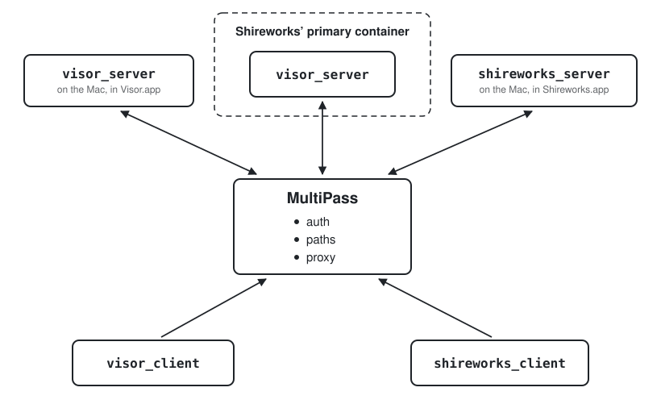

# MultiPass, and a plain server behind it (design, Visor 0.50)

Logan, 10 and 11 Nov 2026: everything about who a client is, where it
comes from, and what credentials a request carries leaves Visor (and
Shireworks) for a standalone app, **MultiPass**. Visor's server becomes a
plain HTTP server on one port, with no authentication of its own, reached
only through MultiPass. Visor 0.49 is the small release before it (isomer
0.50, Shireworks' Visor tab); this is the 0.50 line.

## At a glance

Every client reaches every server through MultiPass, which signs people in,
picks the path (localhost, the LAN, the tailnet) and adds credentials to
what goes out. Servers advertise themselves to it and send their MCP,
GitHub and APNs requests through it.

Visor and Shireworks take the same shape: on a phone the app is its
clients alone; on a Mac it also nests its notarized server, which runs on
Linux by itself as well. Shireworks embeds Visor's client as its Visor tab.

## Decided (Logan, 10–11 Nov)

- **MultiPass is its own repository** (AttilaTheFun/multipass, private,
  Visor's to build: most of its code is Visor's Runner today). A Swift
  menu bar Mac app with a settings window, and the one way into both
  products:
  - **Inbound paths:** it switches between localhost, the LAN and the
    tailnet for Visor's clients and Shireworks' alike, and terminates
    HTTPS (and SSH, where a client has no open port).
  - **Outbound, like Charles:** a request it isn't configured for passes
    through unmodified; a configured URL is rerouted, or has its
    credentials added (GitHub's token, the MCP servers' keys).
- **Sign-in is MultiPass's.** A client adds a MultiPass by copying its
  connection code (its paths and a password; at work Okta in the
  password's place), and that one sign-in reaches every server behind it,
  Visor's and Shireworks' alike. Logan: "one sign in could authenticate
  both shireworks and visor which is cleaner. That also better matches the
  okta model of the enterprise deployment."
- **Servers advertise themselves through it**, as a server in abox does
  through sandcastle at work. Added in Shireworks, a MultiPass gives all of
  its servers (Shireworks' and each Visor server); added in Visor, only the
  Visor servers. Several servers behind one MultiPass is the normal case:
  shireworks_server, a visor_server in Shireworks' primary container, the
  Mac's own visor_server, the Mac mini's.
- **Pushes:** a server keeps its clients' device tokens (uploaded through
  MultiPass), and sends its pushes through MultiPass, which holds the APNs
  key and signs them: no key where an agent in a container could read it.
- **Visor and Shireworks have the same shape:** the GUI app a pure client
  (of Visor's servers; of shireworks_server and GitHub), and a notarized
  server binary nested in the Mac app, which also installs and runs on its
  own on Linux (abox at work; a leased Linux server running containers and
  Ubuntu VMs).
- **A server is told where it is by its environment or its arguments:**
  `VISOR_PORT` (where it listens) and `VISOR_PROXY` (where its requests out
  go: MultiPass), and Shireworks' server the same. No setting of either is
  made over the server's API.
- **Shireworks' primary container has Visor's server baked into its
  image**, configured to send its MCP requests (Shireworks' and Visor's)
  and GitHub's through the port MultiPass listens on, and listening on the
  port MultiPass forwards to.
- **Messages between computers stay client-carried** (the relay: each
  client reports the servers it holds and carries their messages).
  MultiPass carries no messages between servers.
- **Agents are kept from the settings by where they run, not by a token**
  (Logan, 10 Nov: "the goal is eventually all of my sessions will run
  inside containers so the'll never be in an environment where they can
  change the proxy settings"). What an agent must not change (credentials,
  where requests go, who may sign in) is MultiPass's, outside the
  container; the server checks nothing.

## Today

The server does all of it itself:

- **Access** (VisorServer+Access): a password, connection codes carrying
  it, and tokens `hello` hands out; agents get tokens of their own, refused
  on the settings routes.
- **Reaching** (+Reaching, +Listening, TLSIdentity, FrontDoor): loopback or
  every interface, plain or TLS with a given certificate, a socket file for
  clients that come over the computer's own SSH, and the addresses a client
  learns from `hello`. The client probes paths (localhost, LAN, VPN, SSH:
  libraries/visor_ssh) per server.
- **SSH keys** (+SSHKeys): a device authorizes its key into this user's
  `authorized_keys`.
- **Pushes** (+Push, APNsSender, PushSigning, APNsKey): signed with the
  owner's APNs key when this computer has one, else through the push proxy
  (+PushProxy, the Runner's `/apns/`).
- **MCP** (+MCPProxy, MCPProxy): Visor's own MCP for the agents, and the
  configured MCP servers passed on, through the Runner's `/mcp/<name>` for a
  server that holds no keys.
- **GitHub** (+GitHubProxy): agents started with HTTPS_PROXY at the
  Runner's GitHub proxy (libraries/visor_runner's GitHubGate).
- **Containers** (+Containers, +ContainerChecks, +ContainerRegistry,
  +ContainerUpgrades, ContainerHost…, docs/container-host.md): a session's
  agent in a container from a container host, moving in and out, sign-ins
  copied in, the network checked.
- **Fronts** (`visor-server front`, settings' `frontPaths`): the Runner's
  port for a container's server, and the mini's socat forwarders.

The Runner (libraries/visor_runner, applications/visor_runner_agent,
docs/runner-accounts.md) is already most of MultiPass: a sign-in with
sessions (RunnerAuth, RunnerSessions), each server reverse-proxied by path
(`/runner/v1/servers/<id>/…`, HTTP and WebSocket), its own certificate
(RunnerIdentity, RunnerCA), the MCP, GitHub and APNs proxies with a token
per server (`X-Visor-Proxy`), and a watch that starts a server again
(ServerWatch). It moves to the new repository whole, and Visor keeps none
of it.

## The server's contract

What a server needs, whatever runs MultiPass's part (MultiPass on a Mac,
sandcastle at work):

- **One port, HTTP, from `VISOR_PORT`** (`--port`; 7433 by default). The
  REST side under `/api` and the live channel (a WebSocket) at `/`, as
  FrontDoor has them. No TLS, no password, no connection codes. It listens
  on the address it is given (`VISOR_LISTEN`, loopback by default; the
  container's own interface in a container).
- **`GET /api/health`**, answered without credentials and only while the
  server's own loop answers: a keep-alive asks it, so a hung server is made
  again, not only an ended one.
- **Its proxy, from `VISOR_PROXY`**: MultiPass's URL as the server reaches
  it, for everything it sends out:
  - advertising itself (`POST <proxy>/multipass/v1/servers`: its id, kind
    `visor`, name, version, and the address MultiPass reaches it at), again
    when any of it changes and at each start;
  - its agents' MCP servers (`<proxy>/mcp/<name>`) and GitHub (the agents'
    `HTTPS_PROXY` at MultiPass), credentials added there;
  - its pushes (`<proxy>/apns/…`), unsigned, signed there.

  With them its token for MultiPass, from a file (`VISOR_PROXY_TOKEN_FILE`,
  e.g. `/run/secrets/visor-proxy`), never the environment itself or a log,
  sent as `X-Visor-Proxy`. A server without `VISOR_PROXY` advertises nothing,
  sends no pushes and passes no MCP servers on; Visor's own MCP still works.
- **What a request may carry from MultiPass** (optional): `X-Visor-User`,
  the signed-in person's name, for the server to show.
- **Agents** reach it on the same port, as now: Visor's MCP script with the
  session's token, which says which session calls (an identity, not a
  credential).
- **Device tokens**: a client's `POST /api/push` (its token, platform,
  environment, app, the kinds it mutes) arrives through MultiPass and is
  kept by the server, as now.

## MultiPass

Its own repository's design says the rest; what Visor relies on:

- **A connection code**: its paths (localhost, LAN, tailnet, each an
  `https://` address, or SSH) and a password (the fork: Okta's sign-in in
  the password's place). A client adds a MultiPass by it, signs in once,
  and is given a session (a bearer, `Authorization`, or `multipass_session`
  as a query parameter where a WebSocket can send no header).
- **Its servers**: `GET /multipass/v1/servers`, each `id`, `kind`
  (`visor`, `shireworks`), `name`, `version` and state; each one's API and
  channel at `/multipass/v1/servers/<id>/…`, passed on with the person
  checked and nothing of theirs forwarded but `X-Visor-User`. A client
  takes the kinds it shows.
- **Advertising**: `POST /multipass/v1/servers` from a server with its
  token; a server not heard from is shown as away. A server's token is made
  where the server runs (by Shireworks for its primary container, shown
  once; by hand for one run by hand) and set once in MultiPass's settings
  by the person: nothing writes MultiPass's settings for them.
- **Outbound**: `/mcp/<name>`, the agents' GitHub proxy, `/apns/…`, and any
  URL its settings name: rerouted, or with credentials added; anything else
  passed through unmodified.
- **Holds the credentials**: the APNs key, GitHub's tokens, the MCP
  servers' keys. Never a server, never an agent.

## Visor's client

- **A MultiPass is an account**: Add Computer's Sign In takes a MultiPass
  connection code (runner-accounts.md's model, its Runner now MultiPass),
  and the account's Visor servers appear, each a computer under it, its
  address MultiPass's `…/servers/<id>` path. Shireworks' Visor tab
  (VisorView) the same, its own accounts.
- **No code-added computers and no paths of a server's own**: a computer
  is a MultiPass's server, the path MultiPass's (the client picks among a
  MultiPass's addresses, as it does a computer's today).
- **The relay** is unchanged: the client reports every server it is
  connected to and carries messages between them.

## Containers

Visor has no container code. Shireworks keeps a primary container per
computer that asks for one: always on, started again when it stops, not
leased. Visor's server is baked into its image and runs in it as on any
Linux computer, behind MultiPass beside the Mac's own. A session is on the
Mac or in that container by which server it was started on; there is no
moving between them. The contract with Shireworks (its
docs/primary-container.md, shireworks#220):

- **The image**: Visor's agent image, `ghcr.io/attilathefun/visor-agent:<MAJOR.MINOR>`
  (tools/containers/visor-agent), the released line's: `visor-server` and
  `visor-agent-host` in /usr/local/bin, the agents' command lines, git,
  Bazelisk.
- **Its command**: `visor-server run`, with `VISOR_PORT=7433` and
  `VISOR_LISTEN` the container's interface; started again when it stops,
  and made again when `GET /api/health` doesn't answer. Its agents outlive
  a restart under their hosts, as on the Mac.
- **Its proxy**: `VISOR_PROXY=http://{host}:<MultiPass's port>`, `{host}`
  being `SHIREWORKS_HOST_ADDRESS`, the Mac's address on the containers'
  network (their gateway: 192.168.128.1 on the MacBook, configurable, never
  hard-coded); and `VISOR_PROXY_TOKEN_FILE=/run/secrets/visor-proxy`, a
  secret Shireworks makes once and shows once to set in MultiPass.
- **One port forwarded, fixed**: the container's 7433 to a host port fixed
  in Shireworks' settings (`hostPort`), on the Mac's loopback alone, where
  MultiPass reaches the server (the address it advertises).
- **Until MultiPass (interim, Logan and Manager, 11 Nov)**: the primary
  container comes first, so its server keeps a password of its own
  (`VISOR_PASSWORD_FILE`, a secret Shireworks makes and shows once), and
  the hostPort is forwarded on the Mac's loopback, the LAN and the tailnet,
  which `VISOR_FRONT` lists for clients; a client adds it by its connection
  code, as the Mac mini's co-tenant is added. Loopback and the tailnet are
  fine as they are; the LAN is behind the password alone until MultiPass
  takes the port back to loopback.
- **Three volumes**, kept across restarts and new images (no mounts of the
  Mac's folders): `/root`, the home (the server's data at
  ~/.local/share/visor, the agents' sign-ins, conversations and memory);
  `/workspaces`, the cloned source; and `/var/cache/bazel`.
- **Size**: as the co-tenant, 6 to 8 CPUs and 16 to 24 GB; disk about
  20 GB for /root, 50 GB and more for /workspaces, up to 128 GB of Bazel's.

## What goes, and from where

| Goes | Where it is | Taken by |
|---|---|---|
| The Runner: sign-in, sessions, reverse proxy by path, its certificate, the MCP, GitHub and APNs proxies, the server watch | libraries/visor_runner, applications/visor_runner_agent, tests/visor_runner_tests | MultiPass's repository |
| GitHubGate and its rules | libraries/visor_runner, docs/github-gate-rules.md, docs/github-proxy.md | MultiPass's outbound rules |
| Password, connection codes, client tokens, `/codes` | +Access, +Identity, ConnectionCodes (protocol, client) | MultiPass's sign-in |
| TLS, every-interface listening, LAN/VPN addresses in `hello` | +Listening, TLSIdentity, +Reaching | MultiPass's paths |
| The SSH socket and device keys | +Listening's socket file, +SSHKeys, `/ssh/keys`; libraries/visor_ssh in the client | MultiPass's SSH |
| Direct APNs (the key, signing) | APNsKey, PushSigning, APNsSender's signing, `/push/key` | MultiPass's `/apns/` |
| The MCP servers' and push proxy's settings over REST | +MCPProxy's `PUT /mcp`, +PushProxy, +GitHubProxy | MultiPass's settings; the server's `VISOR_PROXY` |
| Container sessions, the host, moving in and out, container checks and upgrades | +Containers, +ContainerChecks, +ContainerRegistry, +ContainerUpgrades, Container*, applications/visor_container_host, docs/container-host.md | Shireworks' primary container |
| Fronts and front paths | `visor-server front`, `frontPaths` | MultiPass's path per server |
| The Mac's server in Visor.app's own process | applications/visor_mac (VisorServer linked in) | the nested `visor-server`, started by Visor.app |
| Code-added computers in the client | AgentServerRecord's password and paths, Add Computer's code | a MultiPass account |

What stays: sessions and agents, transcripts, the relay and mail, Visor's
MCP, push device tokens, migration between servers (client-carried, as the
relay is), the agent hosts that outlive a restart, and the server's own
settings that aren't where it is or who may reach it.

## Versions

- **0.49** (the small release): nothing of this.
- **0.50**: the server takes the contract, MultiPass is the only way in,
  and a 0.50 client reaches servers only through a MultiPass account. A
  0.49 client can't reach a 0.50 server; the release notes say to install
  MultiPass and sign in to it first.
- A server run without MultiPass (the Linux `visor-server` on its own, for
  development) listens on loopback alone, and a client on the same
  computer reaches it there.

## Steps (0.50)

1. This design.
2. **MultiPass's repository**, from the Runner: libraries/visor_runner and
   its agent moved there with their tests, as a menu bar app with a
   settings window (paths, servers, outbound rules, credentials), its
   connection code and sign-in, `/multipass/v1/servers` and advertising.
   Its own design in its repository.
3. **The server's environment**: `VISOR_PORT`, `VISOR_LISTEN`,
   `VISOR_PROXY` and `VISOR_PROXY_TOKEN_FILE`; advertising itself; pushes,
   MCP and GitHub through `VISOR_PROXY` alone; `GET /api/health`. Tests.
4. **Visor.app: the client and the nested server**: `visor-server` in the
   bundle, started and kept up by the app, the server out of its process;
   the Runner's parts out of Visor.
5. **The client's MultiPass accounts**: Add Computer's Sign In takes a
   MultiPass code; records only from accounts; visor_ssh's transport and
   per-server path probing removed.
6. **The server without auth**: the password, codes, tokens for clients,
   TLS, the SSH socket and keys, direct APNs, and the settings routes for
   where requests go removed; `X-Visor-User` shown.
7. **Containers out**: the container code, visor-container-host and the
   fronts removed, with Shireworks' primary container running Visor's
   server in place (its own work, in Shireworks: Containers, above).

Each step is its own pull request with its tests, on the 0.50 line; step 2
in MultiPass's repository, and Shireworks' server and app on the same
shape in Shireworks'.

## Open questions

- **The Mac mini's server**: advertised to the MacBook's MultiPass over the
  tailnet, or a MultiPass of the mini's own that a client adds as a second
  account.
- **SSH at MultiPass**: serving SSH itself, or a client's SSH tunnel to the
  Mac's own sshd reaching MultiPass on loopback (no SSH code at all).
- **MultiPass's port** for servers (the one `VISOR_PROXY` names), and the
  shape of its outbound rules' settings: in MultiPass's design.
